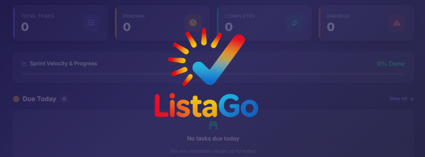

# ListaGo - Kanban Task Management Platform
**Current Version: 2.0** | Next.js + TypeScript Modern Rewrite

A modern, drag-and-drop Kanban task management application built with Next.js 16, React 19, TypeScript, and Zustand. Features a professional Kanban board with project organization, task prioritization, and real-time state management.

## 🚀 Project Structure

This repository contains two versions of ListaGo:

### 🆕 Current: Modern Next.js Kanban (listago-kanban/)
The actively developed version - a full-featured Kanban board with drag-and-drop functionality:
```
listago-kanban/
├── src/
│   ├── app/                 # Next.js App Router
│   │   ├── page.tsx         # Main page
│   │   ├── layout.tsx       # Root layout
│   │   └── globals.css      # Global styles
│   ├── components/          # React Components
│   │   ├── kanban/          # Kanban board components
│   │   │   ├── KanbanBoard.tsx
│   │   │   ├── KanbanCard.tsx
│   │   │   └── KanbanColumn.tsx
│   │   ├── layout/          # Layout components
│   │   │   ├── AppShell.tsx
│   │   │   ├── Header.tsx
│   │   │   └── Sidebar.tsx
│   │   ├── modals/          # Modal dialogs
│   │   │   ├── TaskModal.tsx
│   │   │   ├── ProjectModal.tsx
│   │   │   └── DeleteModal.tsx
│   │   └── ui/              # Shared UI components
│   ├── store/              # Zustand state management
│   │   ├── useTaskStore.ts
│   │   ├── useProjectStore.ts
│   │   └── useUIStore.ts
│   ├── hooks/              # Custom React hooks
│   ├── lib/                # Utility functions
│   └── types/              # TypeScript type definitions
├── public/                 # Static assets
└── package.json           # Dependencies and scripts
```

### 📜 Legacy: Vanilla JavaScript Version (Root Directory)
The original stable v1.1 release with glassmorphism design and dashboard views:
```
/ (root)
├── js/                    # ES6 modules
│   ├── modules/
│   │   ├── taskManager.js
│   │   ├── projectManager.js
│   │   ├── storage.js
│   │   └── ...
│   └── app.js             # Main entry point
├── css/                   # Stylesheets
├── assets/                # Images and favicons
│   └── screenshots/       # App screenshots
├── index.html             # Main HTML file
└── package.json           # Vite configuration
```

## ✨ v2.0 Features (Current Development)

### 🎯 Kanban Board Core
- **Drag & Drop Tasks**: Smooth dnd-kit powered drag-and-drop between columns
- **Task Statuses**: To Do, In Progress, Review, Done columns
- **Task Priorities**: Low, Medium, High, Urgent with visual indicators
- **Create & Edit Tasks**: Comprehensive modal for task management
- **Delete Tasks**: Safe deletion with confirmation modal

### 📁 Project Management
- **Project Organization**: Group tasks into customizable projects
- **Custom Icons & Colors**: Personalize each project with unique styling
- **Project Filtering**: Filter Kanban board by selected project
- **Default Inbox Project**: Built-in project for uncategorized tasks

### 🎨 Modern Design
- **Tailwind CSS 4**: Utility-first modern styling
- **Framer Motion**: Smooth animations and transitions
- **Lucide Icons**: Beautiful, consistent iconography
- **Sonner Notifications**: Elegant toast notifications
- **Fully Responsive**: Works on all screen sizes

### ⚡ State Management
- **Zustand**: Lightweight, performant state management
- **TypeScript**: Full type safety across the entire application
- **Persistent Storage**: LocalStorage persistence for tasks and projects

## 🛠️ Tech Stack (v2.0)
- **Framework**: Next.js 16 (App Router)
- **UI Library**: React 19
- **Language**: TypeScript
- **Styling**: Tailwind CSS 4
- **State Management**: Zustand
- **Drag & Drop**: @dnd-kit/core, @dnd-kit/sortable
- **Animations**: Motion (Framer Motion)
- **Icons**: Lucide React
- **Notifications**: Sonner

## 🚀 Getting Started

### Modern Next.js Version (Recommended)
```bash
cd listago-kanban
npm install
npm run dev
# Open http://localhost:3000
```

### Legacy Vanilla JS Version
```bash
# Serve root directory with any static file server
npx serve .
# Open http://localhost:3000
```

## 📝 Available Scripts (listago-kanban)
- `npm run dev` - Start development server
- `npm run build` - Build for production
- `npm run start` - Start production server
- `npm run lint` - Run ESLint

## 📸 Screenshots (Legacy v1.1)

*Legacy version dashboard view*

## 🔄 Version History
- **v2.0** - Next.js 16 + TypeScript + Kanban rewrite (current development)
- **v1.1** - Stable vanilla JavaScript release with glassmorphism design and comprehensive dashboard

## 📄 License
This project is licensed under the MIT License - see the [LICENSE](LICENSE) file for details.

## 💡 Contributing
This is an active development project. The main focus is currently on the Next.js Kanban version in the `listago-kanban/` directory.