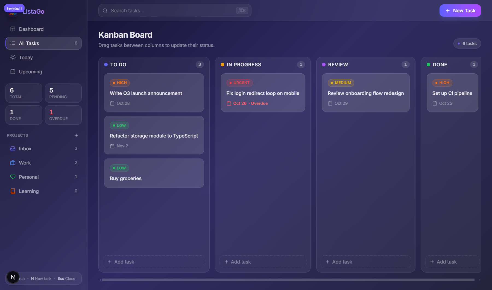

# ListaGo - Kanban Task Management Platform
**Current Version: 2.0** | **Phase 5 complete** | Next.js + TypeScript

A drag-and-drop Kanban task management application built with Next.js 16, React 19, TypeScript, and Zustand. It includes project management, dashboard and date-based views, rich-text task descriptions, keyboard shortcuts, animations, and browser-local persistence.

## 🚀 Project Structure

This repository contains the current ListaGo application in the `listago-kanban/` directory. The old vanilla-JavaScript implementation and its generated build output have been removed so there is one active codebase.

### 🆕 Current: Modern Next.js Kanban ([`listago-kanban/`](listago-kanban/))
The current application is a full-featured Kanban board with drag-and-drop functionality:
```
listago-kanban/
├── src/
│   ├── app/                 # Next.js App Router
│   │   ├── page.tsx         # Main page
│   │   ├── layout.tsx       # Root layout
│   │   └── globals.css      # Global styles
│   ├── components/          # React Components
│   │   ├── kanban/          # Kanban board components
│   │   │   ├── KanbanBoard.tsx
│   │   │   ├── KanbanCard.tsx
│   │   │   └── KanbanColumn.tsx
│   │   ├── layout/          # Layout components
│   │   │   ├── AppShell.tsx
│   │   │   ├── Header.tsx
│   │   │   └── Sidebar.tsx
│   │   ├── modals/          # Modal dialogs
│   │   │   ├── TaskModal.tsx
│   │   │   ├── ProjectModal.tsx
│   │   │   └── DeleteModal.tsx
│   │   └── ui/              # Shared UI components
│   ├── store/              # Zustand state management
│   │   ├── useTaskStore.ts
│   │   ├── useProjectStore.ts
│   │   └── useUIStore.ts
│   ├── hooks/              # Custom React hooks
│   ├── lib/                # Utility functions
│   └── types/              # TypeScript type definitions
├── public/                 # Static assets
└── package.json           # Dependencies and scripts
```

## ✨ ListaGo Features

### 🎯 Kanban Board Core
- **Drag & Drop Tasks**: Smooth dnd-kit powered drag-and-drop between columns
- **Task Statuses**: To Do, In Progress, Review, Done columns
- **Task Priorities**: Low, Medium, High, Urgent with visual indicators
- **Create & Edit Tasks**: Comprehensive modal for task management
- **Delete Tasks**: Safe deletion with confirmation modal

### 📁 Project Management
- **Project Organization**: Group tasks into customizable projects
- **Custom Icons & Colors**: Personalize each project with unique styling
- **Project Filtering**: Filter Kanban board by selected project
- **Default Inbox Project**: Built-in project for uncategorized tasks

### 🎨 Modern Design
- **Tailwind CSS 4**: Utility-first modern styling
- **Framer Motion**: Smooth animations and transitions
- **Lucide Icons**: Beautiful, consistent iconography
- **Sonner Notifications**: Elegant toast notifications that dismiss automatically
- **CKEditor 5**: Rich-text task descriptions with a plain-text fallback
- **Keyboard Shortcuts**: Search, create tasks, navigate, and close dialogs without interrupting text entry
- **Fully Responsive**: Works on all screen sizes

### ⚡ State Management
- **Zustand**: Lightweight, performant state management
- **TypeScript**: Full type safety across the entire application
- **Persistent Storage**: LocalStorage persistence for tasks and projects

## 🛠️ Tech Stack (v2.0)
- **Framework**: Next.js 16 (App Router)
- **UI Library**: React 19
- **Language**: TypeScript
- **Styling**: Tailwind CSS 4
- **State Management**: Zustand
- **Drag & Drop**: @dnd-kit/core, @dnd-kit/sortable
- **Animations**: Framer Motion
- **Icons**: React Icons
- **Notifications**: Sonner

## 🚀 Getting Started

### Modern Next.js Version (Recommended)
```bash
cd listago-kanban
npm ci
npm run dev
# Open http://localhost:3000
```

The root route redirects to `/dashboard`; open `/board` for the Kanban board. See the [application README](listago-kanban/README.md) for full setup details and [project guides](listago-kanban/docs/README.md) for usage, keyboard shortcuts, and architecture.

## 📝 Available Scripts (listago-kanban)
- `npm run dev` - Start development server
- `npm run build` - Build for production
- `npm run start` - Start production server
- `npm run lint` - Run ESLint

## 📸 App Preview



This image and the guide links above use repository-relative paths, so GitHub renders them directly from the default branch once these files are committed and pushed.

## 📄 License
This project is licensed under the MIT License - see the [LICENSE](LICENSE) file for details.

## 💡 Contributing
This is an active development project. The main focus is currently on the Next.js Kanban version in the `listago-kanban/` directory.